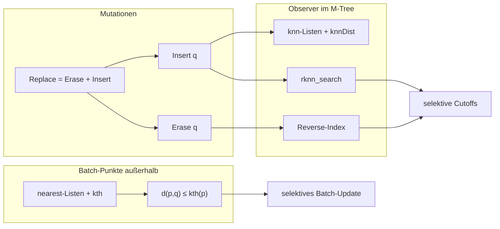

# Plan: RkNN / Nachbarschaftspflege für SDO

Umsetzungsplan. Stand: 2026-11-14 — **A1–A5 in mtree 2.1.0** (opt-in Graph); Layer B/C (sdo) offen.

**Scope dieses Docs:** Roadmap + Design für `mtree` und Consumer `../sdo` (`sdostream` / Cutoffs / Batch-Requery).  
**Verwandte Ideensammlung (kein Auftrag):** `../sdo-benches/RKNN_INCREMENTAL_IDEAS.md`, Algo-Übersicht `RKNN_ALGORITHMS.md`, Achtert-Fit `RKNN_ACHTERT_FIT.md`.  
**Constraints mtree:** [`PERF_NEXT_SDO_SAFE.md`](PERF_NEXT_SDO_SAFE.md) (`&self`-Queries parallel, Filter/Seed/`knn_from_entry`/ε bleiben).

---

## 1. Ziel

Teure **Voll-Requeries** und **Cutoff Full-Invalidate + N× `knn_from_observer`** ersetzen durch selektive Updates. Dieselbe RkNN-Semantik in zwei Grundmengen, plus saubere Mutation (Insert / Erase / Replace).

**Phase 1:** Live-/ungefilterte RkNN-Logik (A1–A5).
**Active (Option A):** zweiter Active-only-`KnnGraph` auf demselben Live-Tree; Membership explizit via `set_active_membership` / `rebuild_active_graph` (nicht Predicate-Diff). Siehe Abschnitt 12.

### 1.1 Warum das lohnt (SDO-Ist)

Pipeline (`../sdo/crates/sdostream/src/pipeline.rs`): Query → Sample/Replace → **Full-Requery aller Batch-Zeilen** → Observe/Predict. Parallel: `CutoffCache` (`cutoff.rs`) speichert nur Skalare; Kommentar *„no nearest-list maintenance“*; `on_live_changed` invalidiert **alle** Density-/Graph-Cutoffs → `ensure_*` recompute per Observer via `knn_from_observer` / `knn_active_from_observer`.

Replace = `remove_observer` + `insert_observer` (neuer `ObserverIndex`), siehe `SdoStreamModel::replace`.

Primärer ROI: **Obs↔Obs** (Cutoff/Density). Batch↔Obs ist zweite Schicht, oft ohne Tree-RkNN.

---

## 2. Varianten-Matrix

| Variante | Frage | Grundmenge | Mechanismus |
|----------|--------|------------|-------------|
| **Obs↔Obs Insert** | Welche Observer bekommen neuen `q` in ihre kNN? | Observer im Tree | `rknn_search(q, k)` / Maintenance-Pass; Listen/Distanz patchen |
| **Obs↔Obs Erase** | Welche Observer hatten `q` in ihrer kNN? | Observer im Tree | Reverse-Index `who_points_to(q)`; Ersatz-kNN für Opfer |
| **Obs↔Obs Update** | Key/Position ändert sich | Observer im Tree | wie sdo heute: **Erase + Insert** (kein separates `update_key`-Protokoll) |
| **Batch↔Obs Insert** | Welche Batch-`p` haben neues `q` im kNN? | Batch + `nearest` | Predicate `d(p,q) ≤ kth(p)`; Liste patchen |
| **Batch↔Obs Erase** | Welche Batch-`p` listen entfernten Observer? | Batch-`nearest` | „enthält q_old“; Lücke füllen (patch oder Mini-Requery) |
| **Batch↔Obs Replace** | Kombination | beides | Erase-Opfer ∪ Insert-Treffer; Rest unverändert |

### 2.1 Formale Affected-Sets (Replace \(p \rightarrow p'\))

| Schicht | Menge | Aktion |
|---------|--------|--------|
| Chunk-`nearest` | Rows mit \(p\) in Hits **oder** \(d(\mathrm{row},p') \le r_k(\mathrm{row})\) | Patch / Full nur für diese |
| Density-Cutoff | \(\mathrm{RkNN}_x(p) \cup \{ q : d(q,p') \le r_x(q) \} \cup \{p'\}\) | nur diese neu |
| Graph-Cutoff | analog active + Rank \(\chi\) | nur stale Actives (Phase 2) |
| Neuer Observer \(p'\) | immer | eine Forward-kNN (Listen füllen) |

\(\mathrm{RkNN}_k(q) = \{ o : q \in \mathrm{kNN}_k(o) \}\) ⟺ \(d(q,o) \le \mathrm{knnDist}_k(o)\).

---

## 3. Hintergrund ELKI / Mk-Trees (für Umsetzung relevant)

ELKI hat RkNN **nicht** am normalen `MTreeIndex` (nur Forward-kNN + Range), sondern an **Mk-Trees** (`MkMax`, `MkTab`, `MkApp`, `MkCoP`) unter `elki-index-mtree/.../mktrees`. `MkTreeRKNNQuery.getRKNN` delegiert nur an `index.reverseKNNQuery`.

### 3.1 MkMax (Kernidee)

- Leaf: `knnDistance` = Distanz zum **k_max**-ten NN.
- Directory: `knnDistance` = **Max** der Kinder.
- Query: Subtree wenn `minDist(q, ball) ≤ knnDistance`; Leaf-Treffer wenn `d(q,o) ≤ o.knnDistance`.
- Bei `k < k_max`: Kandidaten mit k_max, dann Refinement.
- `preInsert`: Maintenance-Hook beim Einfügen — baut kNN von `q`, updated `knnDistance` Betroffener, aggregiert Max nach oben. **Nicht** die geometrische Platzierung im M-Tree.

### 3.2 Erase in ELKI / Achtert

- Klassische Mk-Trees: praktisch **kein** Delete (ELKI `MkMaxTreeIndex.delete` → `NotImplementedException`; MkTab ohne Einzel-Insert).
- Achtert et al. **EDBT’09** ([DOI](https://doi.org/10.1145/1516360.1516462)): RkNN auf plain M-Tree **ohne** precomputed knnDistances (Self-/Mutual-Pruning) — Insert/Delete = normale Index-Updates. Completeness laut Dawar et al. ([arXiv:1506.04867](https://ar5iv.labs.arxiv.org/html/1506.04867)) angreifbar → bei Exact-Pfad brute-force Tests.
- **Unsere Wahl Phase 1:** materialisierte Listen + Reverse (Erase explizit), nicht ELKI-Code (AGPL vs. unser LGPL); Algorithmus neu implementieren. Detailbewertung Achtert-ohne-State: `../sdo-benches/RKNN_ACHTERT_FIT.md`.

### 3.3 Unser M-Tree vs. MkMax

Klassisches Ciaccia/Patella: `covering_radius`, `parent_distance`, LB-PQ-kNN in [`src/search.rs`](../src/search.rs). **Kein** `knnDistance`, **kein** RkNN. Strukturell nah genug als Basis für Mk-Erweiterung; Drop-in unmöglich.

---

## 4. Kostenbild (damit niemand die falschen Teile optimiert)

| Teil | Aufwand | Bemerkung |
|------|---------|-----------|
| Speichern `knnDistance` / Listen | klein | Listen `O(n·k_max)` + Reverse ähnlich |
| Forward-kNN neuer Punkt | in SDO oft **schon bezahlt** | kein echter Mk-Aufpreis |
| Reverse beim Insert | = **RkNN(q)** | ist der Use-Case, nicht „Maintenance on top“ |
| Erase-Opfer finden | billig **mit** Reverse | ohne Reverse: Suche/Überschätzung |
| Ersatz-kNN nach Erase | teuer pro Opfer | Opfermenge typisch klein (~k) |
| Directory-Max-Propagation | moderat | nach Patch |
| RkNN-Query selbst | oft ≪ N Forward-kNNs | Ziel vs. Full-Invalidate |

**Asymmetrie:** Forward-Listen sagen beim Insert **nicht**, wer `q` aufnimmt (das sind die RkNN). Reverse braucht man für Erase und gezieltes Patchen; Insert-Find bleibt RkNN-/preInsert-Pass (gepruneet über gespeicherte Distanzen).

**Zirkel:** Reverse-Insert ≡ RkNN. Mk-Zustand spart diesen Pass nicht beim ersten Mal — er aktualisiert den Cache und macht **spätere** RkNNs/Cutoff-Updates billig. Gewinn gegen heute: **1 Reverse-Pass (+ Patch) ≪ N× Forward-kNN**.

---

## 5. Layer A — mtree (Observer-Index)

### A1. Side-Zustand (Default)

Nicht nur MkMax-Distanz, sondern:

- Pro `EntryId`: Forward-Liste `knn[k_max]` als `(EntryId, dist)` + `knn_distance = dist[k_max-1]`
- Reverse-Adjazenz: `EntryId → Vec<EntryId>`
- Aggregiertes `max_knn_distance` pro `RoutingNode` für Query-Pruning

`k_max` fest (z. B. `max(x, χ)` aus SDO). Side-Array by `slot_index` oder Feld an `ObjectNode`. Ownership: Mutation nur unter `&mut MTree`; Queries unter `&self` (Listen während paralleler Reads nicht mutieren).

**Warum Listen + Reverse:** Erase braucht Opfer-IDs; Cutoffs brauchen k-te Distanz und oft Nachbar-IDs; reines Float (MkMax) reicht für Query-Pruning, nicht für Delete/selektives Cutoff-Patchen.

### A2. Insert `q`

1. Normales M-Tree-Insert (Covering Radii).
2. Forward-kNN von `q` (SDO-Ergebnis übernehmen wenn vorhanden).
3. RkNN-Pass: alle `p` mit `d(p,q) ≤ p.knn_distance` (Pruning: `minDist` vs. `max_knn_distance`).
4. Für jedes `p`: `q` in Liste, schlechtesten droppen, Reverse + `knn_distance` updaten.
5. Directory-Max auf betroffenen Pfaden.

API-Skizze: `insert` mit optionalen `knn_hits`, und/oder `maintain_after_insert(id)`.

### A3. Erase `q`

1. Opfer = `reverse[q]`.
2. Pro Opfer: `q` aus Forward entfernen; **Ersatznachbar** (Forward-kNN oder nächster außerhalb der Liste).
3. Reverse-Kanten von `q`s Forward-Liste lösen; Side freigeben.
4. `erase_by_id`; Max-Aggregate refresh.

### A4. Replace / Update

**Erase dann Insert** (= sdo `replace`). Betroffene = Erase-Opfer ∪ Insert-RkNN-Treffer.

### A5. Query-API

- `rknn_search(needle, k) -> Vec<(EntryId, D)>`
- `rknn_from_entry(id, k) -> …`
- Semantik: `d(needle,o) ≤ knn_dist_k(o)`. Bei `k == k_max` und gepflegten Listen ohne Refinement; bei `k < k_max` Listenpräfix oder Extra-kNN.

Pruning: Subtree skip wenn `minDist(q, ball) > node.max_knn_distance`.

### A6. Tests

- Naive RkNN vs. Index nach Insert-Sequenz
- Erase/Replace: Forward↔Reverse konsistent; `knn_distance` = k-te Listen-Distanz
- Random small sets, `k_max ∈ {1,5,10}`

Lizenz: Algorithmus neu (ELKI AGPL nicht kopieren).

---

## 6. Layer B — sdo Cutoff-Graph (Obs↔Obs)

Datei: `../sdo/crates/sdostream/src/cutoff.rs`.

### B1. Selektiv statt Full-Invalidate

Nach `replace` / `insert_observer` / `remove_observer`:

1. `affected = erase_victims ∪ rknn(new)` (+ neuer Observer).
2. Nur für `affected` Density-/Graph-Skalare neu — ideal aus Listen (`dist[x-1]`, `dist[χ-1]`), sonst gezieltes `knn_from_observer`.
3. Unbetroffene Cache-Einträge behalten.

`live_gen`-Breitband-Bump entfällt im Normalfall; Epoch nur bei Config-Rank-Wechsel.

### B2. ClusterGraph / final_cutoff

ζ-Mischung unverändert. Phase 1: DFS darf noch voll laufen. Phase 2: nur Komponenten mit Schnitt zu `affected`.

---

## 7. Layer C — Batch↔Obs (sdostream Requery)

Batch-Punkte **nicht** im M-Tree; Zeilen haben `nearest: Vec<(ObserverIndex, f64)>`.

### C1. Insert `q`

Pro Zeile: wenn `d(p,q) ≤ kth(p)` → `q` in sortierte Liste mergen (Länge ≤ x), sonst unverändert. Das **ist** RkNN bzgl. der Batch-Menge — ohne Tree-RkNN.

### C2. Erase `q_old`

- Ohne `q_old` in Liste: unverändert
- Mit `q_old`: streichen; Slot nachfüllen (seeded Mini-Requery oder neuer Sample bei Replace)

### C3. Pipeline

`requery` wird zu: inserted/removed Observer sammeln → Patch C1/C2 → Voll-`requery_point` nur bei ungefüllter Liste / Patch-Fail.

---

## 8. Reihenfolge / Todos

1. **mtree A1–A5** — Side-Struktur, Insert/Erase-Maintenance, `rknn_*`, Tests  
2. **sdo B1** — Cutoff selektiv  
3. **sdo C** — Batch-Patch  
4. **Replace verdrahten** end-to-end; messen vs. Profil (`Requery`, Density-Refresh)  
5. Später: Active-only für Graph-χ  

Checkliste:

- [ ] mtree: knn-Listen + knnDistance + Reverse (`k_max`)
- [ ] mtree: Insert-Maintenance (Forward + RkNN-Patch + Max)
- [ ] mtree: Erase-Maintenance (Reverse-Opfer + Ersatz-kNN)
- [ ] mtree: `rknn_search` / `rknn_from_entry` + Naive-Tests
- [ ] sdo: CutoffCache selektiv statt `on_live_changed` all
- [ ] sdo: Batch-requery Predicate + Delete-Opfer
- [ ] sdo: replace/insert/remove verdrahten; Active später

---

## 9. Bewusst nicht

- ELKI-Code portieren (AGPL)
- MkTab-Distanzvektoren ohne IDs (Erase/Cutoff brauchen Nachbar-Identität)
- Active als zweiter MTree (Option B verworfen)
- Batch-Punkte in den M-Tree indexieren
- Index-Wechsel (HNSW o. ä.) — siehe Ideendokument; Default bleibt mtree + Side-Graph

---

## 10. Wichtige Dateizeiger

| Ort | Rolle |
|-----|--------|
| [`src/search.rs`](../src/search.rs) | Forward-kNN, Bounds — Vorbild für RkNN-Traversal |
| [`src/node.rs`](../src/node.rs) | `RoutingNode` / `ObjectNode` — Anknüpfung Side-State |
| [`src/tree.rs`](../src/tree.rs) | Insert/Erase/Cover |
| `../sdo/crates/sdostream/src/cutoff.rs` | Skalar-Cache, Full-Invalidate |
| `../sdo/crates/sdostream/src/pipeline.rs` | `requery` / Sample-Replace |
| `../sdo/crates/sdostream/src/model.rs` | `replace`, `refresh_density` |
| `../sdo/crates/sdo/src/tree_index.rs` | Wrapper `EntryId` ↔ `ObserverIndex` |

---

## 11. Stand A1–A5 (Branch `feat/rknn-side-graph`)

Umgesetzt in **mtree** (opt-in Graph, Default unverändert):

| Item | Status |
|------|--------|
| A1 Side-Zustand (`KnnGraph`, `max_knn_distance`) | erledigt — [`src/knn_graph.rs`](../src/knn_graph.rs), [`src/node.rs`](../src/node.rs) |
| A2 Insert-Maintenance (One-Walk / Hits) | erledigt — Hooks in [`src/tree.rs`](../src/tree.rs), Logik in [`src/rknn.rs`](../src/rknn.rs) |
| A3 Erase + `update_key` | erledigt |
| A4 Replace = erase+insert | erledigt (Aufrufer-seitig) |
| A5 `rknn_search` / `rknn_from_entry` | erledigt |
| Tests | `cargo test` inkl. `rknn_*` |
| Benches | Sibling `../mtree-experiment` Bench `rknn_graph` |

API-Skizze: `MTree::with_knn_graph(k_max, dist)`, `with_capacity_hint_knn_graph`, `insert_with_knn_hits`, `rknn_search`, `rknn_from_entry`, `knn_graph_neighbors`.

**Active (Option A):** `knn_graph_active` + Membership-Bitset + `max_knn_distance_active`; APIs `with_knn_graphs` / `enable_active_knn_graph`, `set_active_membership`, `rebuild_active_graph`, `rknn_active_*`. SDO: `TreeIndex` startet mit beiden Graphen; `fit` → `sync_active_knn_graph`; Graph-χ bevorzugt Active-Listen.

**Noch offen:** Layer B/C selektive Cutoffs/Batch-Requery (teilweise: `invalidate_graph_for`).

---

## 12. Active-RkNN (Option A) — Stand

| Stück | Status |
|-------|--------|
| Zweiter `KnnGraph` + Membership | erledigt |
| `rebuild_active_graph` / Batch-Diff + Auto-Rebuild (~25%) | erledigt |
| Tree-Erase/Insert-Kopplung nur bei Membership | erledigt |
| `rknn_active_*` | erledigt |
| SDO `sync_active_knn_graph` nach `fit` | erledigt |
| Graph-Cutoff aus Active-Listen | erledigt (Fallback: `knn_active_from_observer`) |
